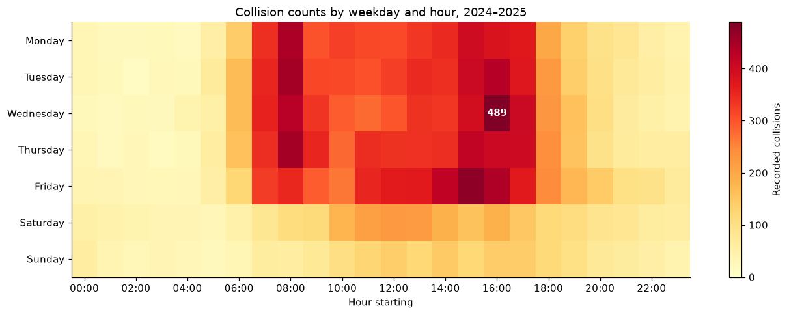

# Goods-vehicle collision patterns in Great Britain

An exploratory analysis of police-reported injury collisions involving vans or goods vehicles in Great Britain during 2024–2025. Completed for M504, AI and Applications, at Gisma University of Applied Sciences.

**Author:** Ahmad Sajjad Siddiqui

The question is where a hypothetical fleet-safety consultancy should investigate driver training and operational reviews. I link collision, vehicle and casualty records, check their consistency, and compare casualty burden, timing, geography, road settings and environmental conditions.

## Findings

The supplied snapshot contains **202,452 collisions**, **367,462 vehicle records** and **256,155 casualties**. Selecting collisions involving vehicle types 19/20/21/98 yields **29,402 collisions and 38,433 casualties**. All casualties in those collisions are included.

- Casualties in eligible collisions increased from 18,385 in 2024 to 20,048 in 2025. The adjusted killed-or-seriously-injured share changed little: 21.87% to 21.92%.
- Wednesday, 16:00–16:59 had the highest combined weekday/hour collision count, with 489 records.
- On rural 60 mph roads, adjusted severe-collision shares were 38.84% in darkness and 33.37% in daylight. Daylight still accounted for more recorded collisions.

These observations support further review against client routes and mileage. They do not demonstrate that a training intervention works or estimate risk per journey.



## Method

The notebook enforces unique keys, parent-record links, year consistency and reconciliation of vehicle/casualty counts. It handles missing codes by field, checks severity-adjustment probabilities, and keeps collision and casualty denominators separate. Annual and stratified comparisons qualify pooled patterns. The code guide's `2024_code_list` is used; a weather-label issue in another sheet is discussed in the notebook.

## Run

Validated environment and results are recorded in [reports/VALIDATION.md](reports/VALIDATION.md). Use Python 3.12.14 for the recorded environment.

```sh
python -m venv .venv
```

Activate it with `.venv\Scripts\Activate.ps1` in PowerShell, or `source .venv/bin/activate` on macOS/Linux. Then:

```sh
python -m pip install -r requirements-run.txt
python scripts/data.py --extract
python run_analysis.py
```

The runner verifies all seven input hashes, starts a fresh kernel using the active Python interpreter, and saves a separate executed notebook under `reports/`. It leaves the portfolio notebook unchanged. For interactive work, open `fleet_safety_analysis.ipynb` in a notebook editor with this environment selected and run it from the repository root.

The seven inputs are supplied as one compact archive; extracted files are excluded from Git. [data/README.md](data/README.md) identifies the sources and snapshot. The archive and every extracted file are checked by SHA-256. Current official downloads differ from this historical snapshot, so they must not silently replace it.

## Limits

The data covers police-reported injury collisions on public roads. It excludes unreported and damage-only incidents. Goods-vehicle involvement does not identify commercial ownership, journey purpose, fault or causation. Mileage and journey counts are unavailable. Reporting practices, geographic boundaries, unknown codes and small groups affect comparisons. Severity adjustment does not remove confounding; two years do not establish a trend. Business benefit and cost savings have not been measured.

## Sources and portfolio preparation

Data: Department for Transport, [Road safety open data](https://www.gov.uk/government/statistical-data-sets/road-safety-open-data). Contains public sector information licensed under the [Open Government Licence v3.0](https://www.nationalarchives.gov.uk/doc/open-government-licence/version/3/), except where otherwise stated by the source. No official endorsement is implied. Further methodological references remain in the notebook.

This portfolio copy adds reproduction instructions and checks. Its analysis code is unchanged from the notebook matched to the final submitted HTML. The original submission is retained privately. See [RIGHTS.md](RIGHTS.md) for the current rights and licence status.
